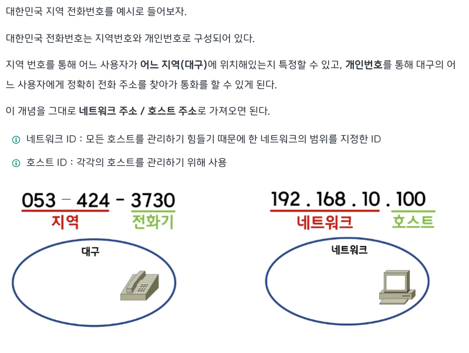
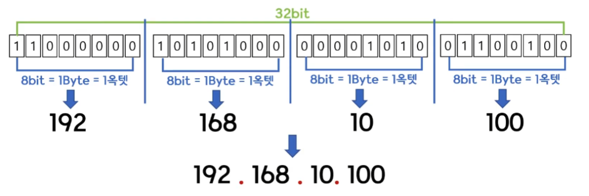
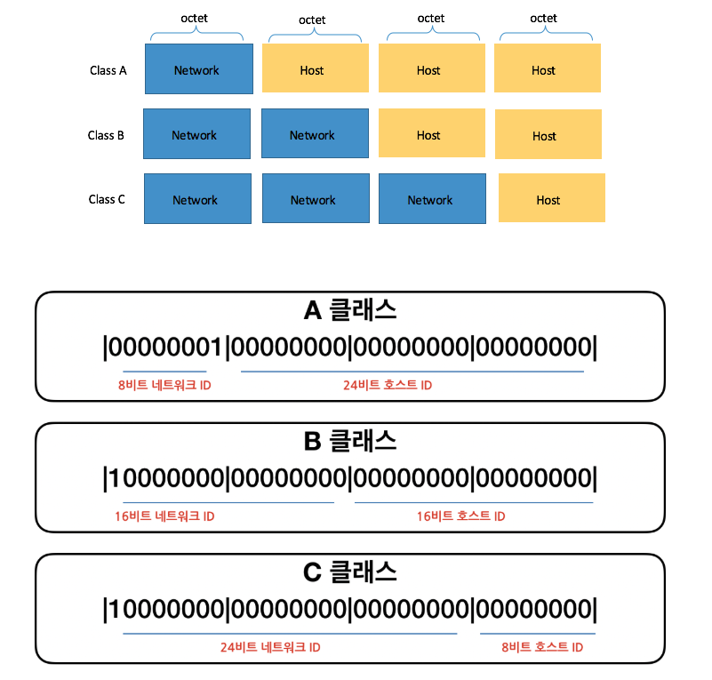
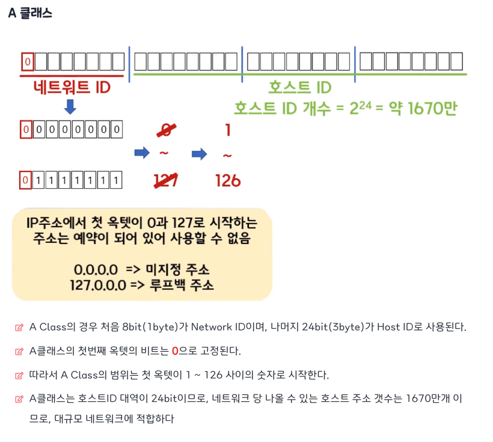
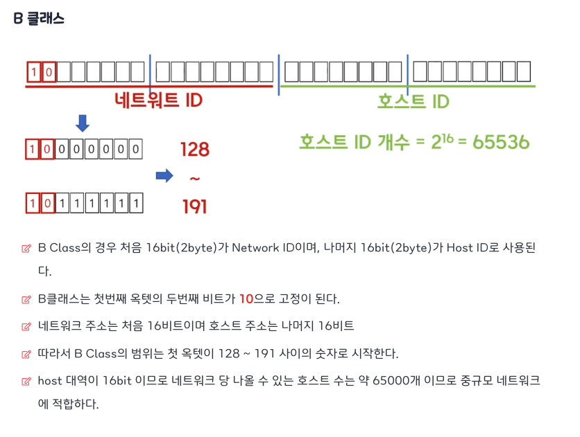
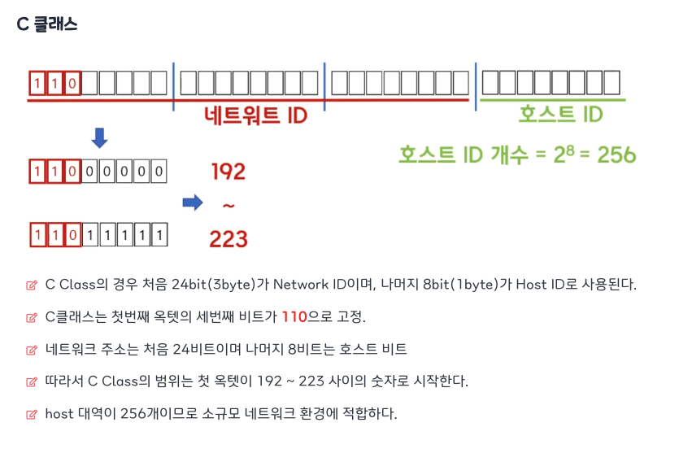
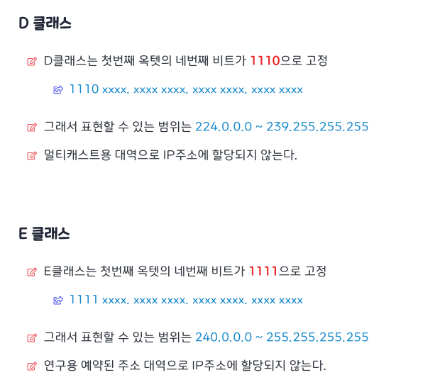
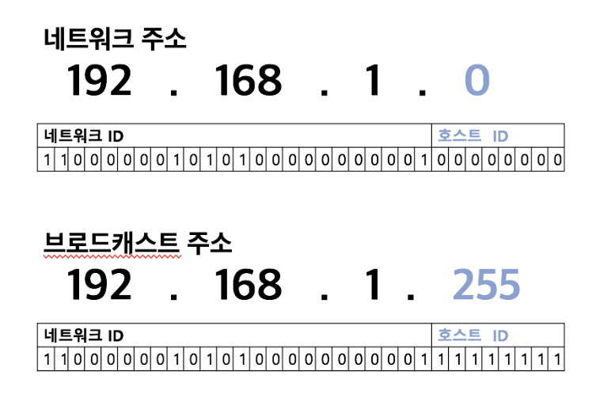
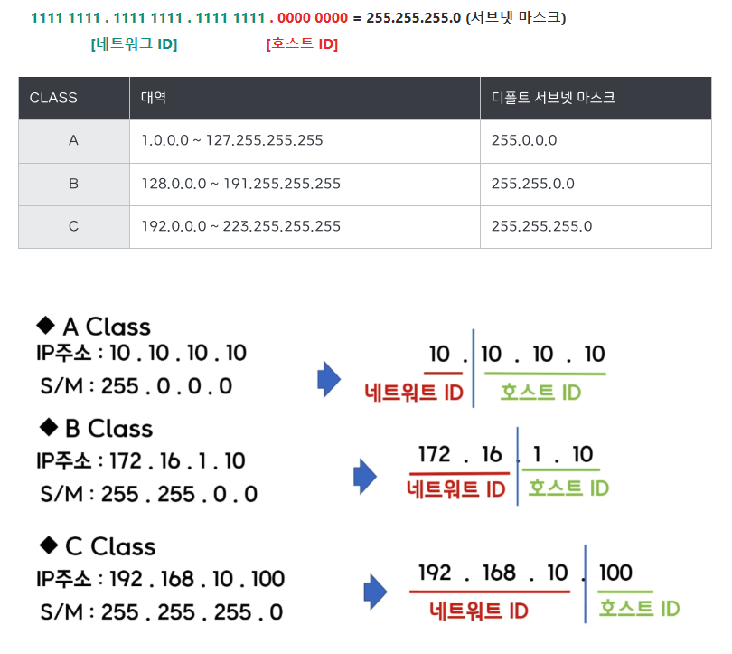
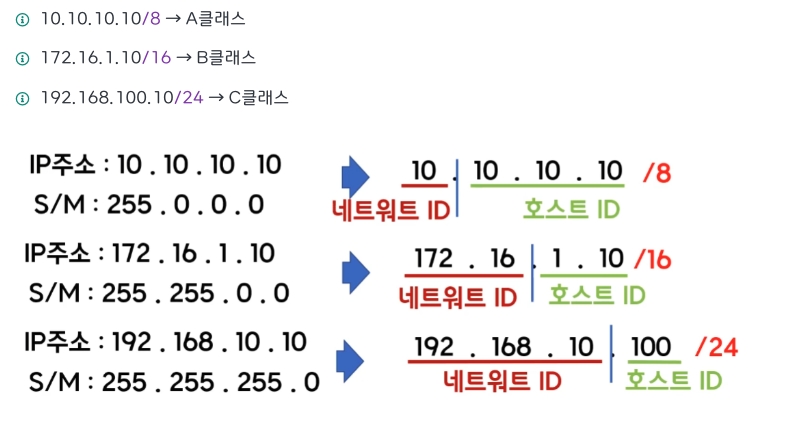

## IP 클래스

**IP 정리**

IP(Internet Protocol)란 인터넷에 연결되어 있는 모든 장치들(컴퓨터, 서버 장비, 스마트폰 등)을 식별할 수 있도록 각각의 장비에게 부여되는 고유 주소이다.

IP는 일반적으로 192.168.123.132와 같이 마침표로 구분된 4개의 숫자가 있는, 점으로 분리된 10진수 형식으로 표시된다.

이를 2진법으로 표현한ㄴ다면, 32 비트 숫자 1000000.10101000.01111011.10000100 가 된다.

즉, IP는 32 bit로 이루어진 주소이며, 1bit가 2이니까 2의 32승, 약 43억개의 주소를 가지게 된다.

---

### IP 주소 구성

아이피는 **네트워크 ID** + **호스트 ID**로 구성되어 진다.

네트워크 ID는 예를 들어 Host들을 관리하기 힘드니 각 국가마다 Network ID를 부여한다고 보면 된다. 그럼 네트워크 아이디가 같으면 어떤 국가인지 알 수 있게 된다.

그리고 호스트 ID는 호스트들을 개별적으로 관리하기 위해 사용하게 된 것이다. 즉, 국가와 국민에 해당한다.

따라서 우리가 인터넷을 사용할 때, 목적지를 알아내고 찾아가기 위해서는 네트워크 ID와 호스트 ID가 합쳐진 IP 주소를 보게 된다.

예를 들어, 다음과 같은 IP 주소가 있다고 하자:

**192.168.10**.10 → **11000000.10101000.00001010**.00001010
 
네트워크 주소는 **11000000.10101000.00000010** 이 되고, 나머지 부분인 00001010은 호스트 주소가 된다.
그리고 192.168.10. 으로 시작하는 PC는 192.168.10.10, 192.168.10.25, 192.168.10.126 ...과 같은 네트워크에 속하고 있다고 말 할 수 있다.

---

### IP 주소 클래스

IP 클래스는 예전에 IPv4를 사용했을 때 IP를 할당하는 방법이었다.

지금은 더 이상 사용되지 않고, 클래스 방식이 아닌 다른 방식(CIDR)으로 할당하도록 1993년도에 바뀌었지만, 서브네팅을 하기 위해선 기본 개념은 알고 가야하기 때문에 학습이 필요한 부분이다.

IP 주소를 8비트로 4등분을 하면, 각각을 옥텟(Octet)이라 부른다.
각 옥텟별로 0~255개의 범위가 되므로 각각 256개가 들어갈 수 있게 된다.

그리고 이 옥텟 별로 IP의 클래스를 A,B,C로 나눌 수 잇다.

각 클래스마다 위에서 배운 네트워크 ID 부분과 호스트 ID 부분 범위가 서로 다른것을 볼 수 있다.

---

### 네트워크 주소 & 브로드 캐스트 주소

여기서 유의할 점이 있는데, 아이피 주소에서 사용할 수 없는 주소가 두가지가 존재한다.

가장 첫번째 호스트 주소는 네트워크자체를 지칭하며, 마지막 주소는 브로드캐스트용 주소로 쓰인다.

네트워크 주소는 말 그대로 네트워크 자체를 나타내는거고, 브로드 캐스트 주소는 인터넷 데이터를 전달하기 위한 주소로서, 이것은 모든 네트워크 아이피 클래스에서 동일하게 적용 되는 것이므로 주의해야 한다.
한 네트워크를 나타내는 주소나 데이터를 전달하기 위한 주소를 PC에서 사용하면 문제가 생기기 때문에 사용할 수 없는 주소로 정리 하면 된다.

다음과 같이 사용할 수 있는 아이피 주소 범위가 있다고 하자.

192.168.10.0 ~ 192.168.19.255

여기서 첫 번째 

여기서 첫번째 192.168.10.0은 192.168.10 의 네트워크 자체를 가리키고,
맨 마지막 192.168.10.255가 브로드캐스트용 주소가 되게 된다.
그리고 그 사이의 192.168.10.1 ~ 192.168.10.254 주소들을 우리가 실제로 사용하는 것이다.

>그중 192.168.10.1은 보통 공유기(라우터)가 가져가게 된다. 그래서 보통 사용자들은 192.168.10.2 부터 할당 받는 편이다.

--- 

## 서브넷 / 서브넷 마스크 / 서브네팅 총 정리 

서브넷, 서브넷 마스크, 서브네팅 같은 단어이면서 아닌듯한 이 용어에 대해 정확히 짚어보자.
 
서브넷(Subnet)
앞서 배웠듯이 IPv4는 초기에 부족한 아이피 주소를 해결하기위해 ip 클래스로 나누어서 할당을 방법을 택했다.

* **A 클래스**
    * 네트워크 주소 범위: 1.0.0.0 ~ 126.0.0.0
    * 호스트 ID 개수 : 약 1679만개
* **B 클래스**
    * 네트워크 주소 범위: 127.0.0.0 ~ 191.255.0.0
    * 호스트 ID 개수 : 65,536개
* **A 클래스**
    * 네트워크 주소 범위: 192.0.0.0 ~ 223.255.255.0
    * 호스트 ID 개수 : 256개

하지만 사용해보니 이 방식은 오히려 비효율적 인 것이었다.
 
 
클래스 B를 어느 중소기업체에게 할당했을 경우 만일 그 기업이 65000여개의 아이피를 다 쓰는 것이 아닌 10000개 정도만 쓴다고 가정해보자. 
그럼 나머지 50000여개의 IP는 쓰이지 않은 채 이 기업체는 클래스 B의 하나를 점유하고 있는 상태가 되어 버린다.
그렇다고 이 기업체에게 C 클래스 IP(256개)를 할당하자니 IP자원이 너무 부족하게 되어 버린다.
 
즉, 호스트 수에 맞게 IP를 클래스별로 나누어 놓았더니만 안하만도 못한 현상이 발생한 것이다.
이도 저도 아닌 이러한 문제를 해결하기 위해 IP를 사용하는 네트워크 장치 수에 따라 효율적으로 사용할 수 있는 **서브넷(Subnet)** 개념이 등장하게 되었다.

* **서브넷(Subnet)** 이라는 것은 하나의 네트워크가 분할되어 나눠진 작은 네트워크이다.
* 서브넷을 만들기위해 네트워크를 분할하는 것을 **서브네팅(Subnettin)**이라고 한다. 서브네팅을 하면 IP 할당 범위를 더 작은 단위로 쪼갤수 있게 된다. 그래서 만일 ip가 100개만 필요하다면 C클래스(256개)를 더 쪼개서 줄 수 있다.
* 그리고 이 서브네팅을 **서브넷 마스크(Subnet Mask)**를 통하여 계산되어 수행된다.

세가지 용어에 대해서 명확히 정리가 되어졌다.
그럼 이제 서브넷 마스크로 서브네팅을 하는 방법을 알아보도록 하자.

### 서브넷

서브넷 마스크는 ip주소에서 네트워크 ID와 호스트 ID로 구분하기 위한 목적으로 만들어 졌다.
물론 ip클래스마다 주소 범위가 정해져있어서 앞자리만 보고도 어느 클래스인지 판별할 수는 있긴 하지만 보다 쉽게 구분하기 위해서 고유의 표기법으로 구분한다고 이해하면 된다.
 
**서브넷 마스크 표현**
서브넷 마스크는 IP주소와 똑같은 32비트 2진수로 표현된다.
255.255.255.0 
 
여기서 아이피와 표현이 다른 점은 서브넷 마스크는 연속된 1과 연속된 0으로 구성되어있다는 것이다.
* 즉, 10011111.11011111.11110011.00000000 와 같이 *1 중간에 0 이 들어오는 값은 가질 수 없고*, 
* 11111111.11111111.11111100.00000000의 *1이 연속되거나 아닌 형태만 가질 수 있다*는 말이다.
 

앞서, 서브넷 마스크는 네트워크 아이디와 호스트 아이디를 보다 편하게 구분하기 위해 사용된다라고 했었다.

다음 사진을 보면 그 원리를 쉽게 이해할 수 있을 것이다.
서브넷 마스크 옥텟(1바이트)가 255면 즉 네트워크 아이디를 가리키게 되는 것이다.
그래서 아주 간단하게 IP주소와 서브넷 마스크를 이용해서 이 IP가 어느 클래스인지 알 수 있다.

**Prefix 표현**
서브넷 마스크를 위보다 더욱 간소화해서 표현할 수도 있다.바로 비트를 이용한 방법인데, 
IP 주소가 192.168.0.1/24 라면 뒤에 /24가 서브넷 마스크를 표현한 것이다.

/24 라는 뜻은 32비트 중 앞에서부터 차례대로 1의 개수가 24개라는 의미이다. 나머지 32-24=8은 0으로 채워주면 서브넷 마스크 숫자가 되는 것이다.
 
/24  →  11111111.11111111.11111111.00000000 
 
기존의 서브넷을 나타내는 방법 255.255.255.0 을 /24 

즉, 네트워크에 해당하는 비트의 수로 표시하는 방식을 말한다고 보면 된다.

이렇게 하면 IP 주소를 입력할 때 192.168.1.17 255.255.255.0 를 192.168.1.17/24로 간략히 줄일 수 있게 된다.

서브넷 정보를 알려주기 위해 기존에는 4B가 필요했지만 6bit만 있으면 해당 정보를 전달할 수 있어서 네트워크 리소스를 절약할 수 있다.

---

### 서브네팅 계산법
https://inpa.tistory.com/entry/WEB-IP-%ED%81%B4%EB%9E%98%EC%8A%A4-%EC%84%9C%EB%B8%8C%EB%84%B7-%EB%A7%88%EC%8A%A4%ED%81%AC-%EC%84%9C%EB%B8%8C%EB%84%B7%ED%8C%85-%EC%B4%9D%EC%A0%95%EB%A6%AC

